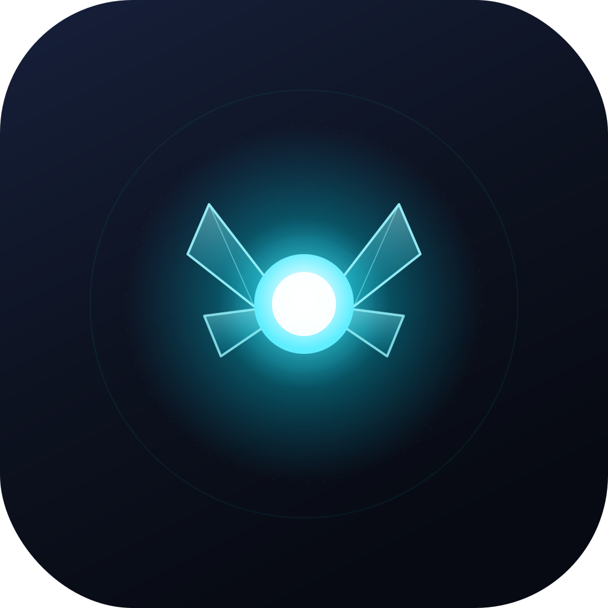
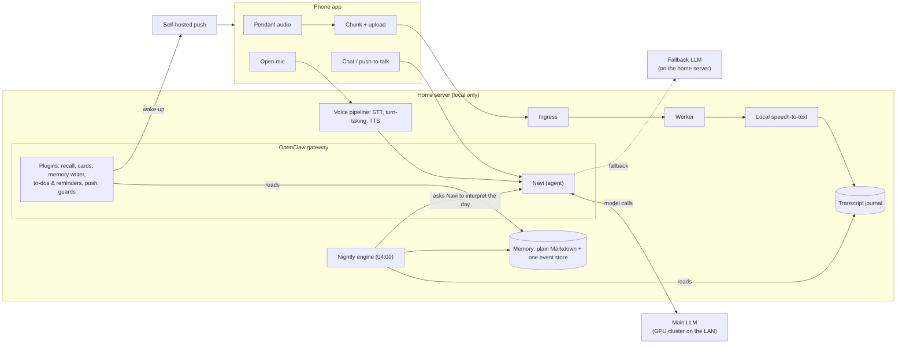

# Navi

**A personal companion that runs at home: "a secretary who knows you really well."**

> **Work in progress, documented as we go.** Navi is not finished, not packaged and not meant for distribution.
> We're writing up how she's built while we build her, in case anyone wants to pull something useful out of it.
> There's nothing to install yet. See [STATUS.md](STATUS.md) for what runs today and [VISION.md](VISION.md) for
> where it's headed.

Navi hears the owner's day (a clip-on pendant, chat, voice), works out overnight what happened and what matters,
and in the morning tells him only that. She keeps track of people, promises and plans, and reminds him when it counts.
She runs on [OpenClaw](https://github.com/openclaw/openclaw), on hardware at home, with local models.

**Built by a non-developer.** In the owner's words: *"I'm not a developer. I built a team of agents that let me rant
and explain my goals, and then they build the systems."* One AI agent leads the engineering, specialists own the app
and voice, and an operator agent makes every live change from written work orders. How that works in practice
(and where it breaks) is half of what this repo documents. See [How it is built](#how-it-is-built-one-owner-several-ai-engineers-one-operator).

---

## Why she exists

**A family health crisis.** For a stretch, the owner's life stopped being orderly. There were calls, decisions,
promises made on the move, and stacks of legal, financial and medical paperwork (power-of-attorney forms, hospital
discharge papers) that had to be understood and filed fast. What he needed wasn't a chatbot. It was a backbone: something that
heard the day, kept track of who said what and what he'd agreed to, and could read a pile of documents and tell him
what actually mattered and what to do next.

**Navi couldn't hold it together yet. Blexi could.** Blexi is his older, fully local OpenClaw agent. He scanned the paperwork
in and handed it to her, and he was comfortable doing that *because* she was local only: none of it left the house.
Both ran on **the same GPU cluster and the same model**. The first Navi was very smart, but she sat on a home-grown
harness without the tools or infrastructure OpenClaw has. Each piece worked on its own; the connections between
them (memory, tools, sessions, the capture feed) kept breaking. So instead of having Navi do the work she was being designed
for, he handed it to Blexi and gave her access to the ambient capture feed, and she did it. That was the "oh" moment:
**the model was never the problem; the system around it was.** It's why Navi runs on OpenClaw today, and why her
memory lives in plain files that another agent can pick up.

**A pendant that proved the idea, and its two costs.** Before Navi had ears, he bought an
[Omi](https://www.omi.me/) pendant and its subscription, and was genuinely impressed. The moment it clicked:

> While painting a light fixture, he noticed a smudge and said aloud, "remind me tomorrow, when this dries, to sand
> that down and repaint it." The next morning his phone said: *don't forget to sand and paint the light fixture.*

But every word of every day went through cloud models. That had two costs: **privacy** (a day's audio is the most
private data anyone has) and **money** (parsing ambient audio around the clock adds up). So the goal became clear:
**a local-only Omi with the power of OpenClaw behind it**, with projects, current state, people, plans and
reminders, on the kind of harness that would have taken years to build by hand.

## Where she's going

The goal is an assistant that **acts on the owner's behalf**, inside clear permission boundaries, because she knows
his people, his projects and how he works. Today she proposes and he decides. Capability grows step by step. Some
boundaries stay for good: destructive actions, sending things out, new spending and changes to her own permissions
will always need him.

- **Navi as the primary agent:** coordinating the other agents in his life, keeping them on task, and handing work
  between them.
- **All of his context, kept securely:** email, calendar, finances, health and private notes, stored locally and used
  with permission. More context makes her more useful, as long as it's kept safely.
- **Fully local:** speech and memory already are; a smaller model on the home server is being prepared as a
  fallback, and the aim is to need no cloud model for anything personal.
- **Portable:** a planned move to a new machine is the first real test that her memory and plugins survive a change
  of home.
- **Open source:** a clean, ground-up rebuild on synthetic data, using this system as the reference and the test
  oracle.

The longer version is in [VISION.md](VISION.md). The order of work is in [ROADMAP.md](ROADMAP.md).

## What she does today

| Works today | Not yet |
|---|---|
| Ambient capture from a pendant through the phone app to a home server, transcribed locally | Email and calendar as evidence |
| A nightly memory engine: day summaries, people and situation pages, a "current world" page | A memory redesign (the active work: fewer, better-shaped stores) |
| A morning briefing on request, with at most three questions | A local fallback LLM on the home server for when the main GPU cluster is down ([deep dive](docs/local-fallback-llm-strix-halo.md)) |
| Recall in conversation: she finds history without being told where to look | Offers in the moment ("shadow mode" is in round 2 of tuning; see [lessons](docs/lessons-learned.md)) |
| Person and situation "cards" put in front of a message when it mentions someone she knows | A real-time "is this the owner speaking?" score for each chunk |
| A to-do list and reminders that ring on the phone, with Done / Snooze on the lock screen | Acting on his behalf, inside permission boundaries |
| Hands-free voice ("open mic"), push-to-talk and read-aloud, all speech models local | Moving the whole system to a new machine; the clean open-source rebuild |

## How it fits together

**The short version:**

- **Evidence comes in all day.** The app cuts pendant audio into one-minute chunks and uploads them over a private
  network. The home server transcribes each chunk locally, appends the text to a journal, and deletes the audio.
  [Ambient capture deep dive](docs/ambient-capture-pipeline.md).
- **Understanding happens at night.** At 04:00 an external program reads the day, stitches chunks into
  conversations, labels them (real life, TV, dictation, garbled), and then asks *Navi herself* to interpret the day,
  update what she knows, and write the briefing. Code does the plumbing; the agent does the meaning.
  [Nightly engine deep dive](docs/nightly-memory-engine.md).
- **In conversation she already knows the state of things,** because a plugin puts a short "current world" page and
  any relevant person cards in front of each message, and gives her read-only recall tools for the rest.

## Built on OpenClaw, without forking it

OpenClaw is the agent harness: gateway, sessions, tools, cron, model routing and failover, plugins. It gave this
project what a home-grown harness couldn't, and it's the reason a non-developer can run a system this size at all.
The rule from
day one: **use native features first, plugins for anything bespoke, and never modify OpenClaw core**, so Navi
survives upgrades and could move to another harness.

- **Plugins** (each small, versioned, installed with OpenClaw's own plugin command): recall and morning questions;
  person cards; the memory writer (the only writer to the fact store); to-dos and reminders; push wake-ups; and a
  pre-tool guard that limits what the agent may write (for example, her own notebook may only be appended to).
- **The nightly engine is not a plugin.** It is an external Node program that drives a standing OpenClaw automation
  job through the gateway API, so it can be tested on its own and replaced without touching the agent.
- **Memory is portable:** plain Markdown pages plus one small event-sourced store. Every index can be rebuilt.
- **Honest footnote:** one small patch to OpenClaw core (about 17 lines, in how sub-agent completion status is
  reported) predates the rule. It is tracked, and every upgrade must carry it or drop it on purpose.

## How it is built: one owner, several AI engineers, one operator

The owner sets goals and limits and makes product decisions; he is not an engineer and often works from his phone.
The engineering is done by AI agents with clear lanes:

| Role | Who | Does |
|---|---|---|
| Owner | a person | Goals, boundaries, product calls, physical tasks |
| Lead engineer ("Core") | a Claude Code session | The nightly engine, memory, plan, roadmap; dispatches and verifies everyone else's work |
| Specialists | more Claude Code sessions | The Android app, voice, future research. Each in its own repo or worktree |
| Operator | a separate OpenClaw agent on the operator machine | Makes **all live changes** on the home server, from written work orders |
| Navi herself | the product | Also a reviewer: she can't see the backend, so her views are useful and sometimes wrong |

Engineers never change the live system directly. They write a **work order** (exact steps, acceptance checks,
rollback) and post it to a ticket **mailbox**; the operator claims it, does it, and files a receipt and a report.
A short list of **hard stops** (anything public, kernel and firmware, deleting private data, new spending,
changing the rules themselves) always goes back to the owner. [Work-order loop deep dive](docs/operator-agent-work-orders.md).

Every finished piece of work gets a **ledger entry**: what was built, why, the evidence, what failed and what is now
vestigial. Claims are tagged *verified*, *documented*, *inferred* or *unknown*. The ledger is what makes a later
clean rebuild possible.

## Hardware

Local models are the point, so here is the stack:

- **Navi's brain:** four Founders Edition **NVIDIA DGX Sparks**, 128 GB each, linked to each other through a
  dedicated 100 Gb MikroTik switch so the four nodes act as one shared pool. They serve **DeepSeek V4.1 Flash**, split across all four nodes
  (tensor parallel).
- **Navi's home:** an **AMD Strix Halo** mini PC with 128 GB. It runs the OpenClaw install, the memory stores, every
  speech model, and the smaller models. A local fallback LLM for when the cluster is down is being prepared there;
  it isn't working properly yet.
- **The operator machine:** an **Apple M4 Max Mac Studio** with 128 GB, always on, running the operator agent.
- **Network:** everything else, including each Spark's ordinary network link, the server and the Macs, is on a
  10 Gb core switch. The 100 Gb switch carries only the traffic between the Sparks.
- **Phone app:** Android, with a dedicated test tablet, so changes are proven there before they reach the owner's phone.

**Why this mix matters:** it spans **Apple, AMD and NVIDIA**, so all three kinds of memory architecture, plus Linux
and Windows machines. Between them they can run essentially any local-model software stack. **The open gap:**
dedicated GPU memory (CUDA on a discrete card) isn't used yet. A gaming PC with one is the next piece to bring in.

Speech: a Whisper-family turbo model on the integrated GPU for the pendant; Parakeet on the CPU for open mic; Kokoro
and Pocket TTS for speech out; Pipecat for the live voice loop. Details in the deep dives.

## Principles we kept coming back to

1. **Local-first.** Sensitive data ends up local only. No cloud speech, no cloud memory.
2. **Boundaries persist; capability grows.** She earns new abilities one at a time. Destructive actions, sends,
   spending and permission changes always need the owner.
3. **Degrade, never fail whole,** and say so. A missing day is never presented as an empty day.
4. **Every degraded outcome reaches a human.** A watchdog that counts "degraded" as "healthy" hides failures.
5. **Trust the agent's reasoning over keyword tripwires,** and keep code for format and safety.
6. **Voice-ID scores and labels are logs, never permissions.**
7. **Never drop foreign-language speech** anywhere in the pipeline.
8. **Research complete open-source projects and native features before building anything by hand.**

## Read more

| Deep dive | What's in it |
|---|---|
| [The nightly memory engine](docs/nightly-memory-engine.md) | Stages, the "agent does the meaning" contract, write-once days, budgets |
| [Ambient capture pipeline](docs/ambient-capture-pipeline.md) | Pendant to journal: custody, validation, deletion, open mic |
| [A fallback LLM on Strix Halo beside live speech-to-text](docs/local-fallback-llm-strix-halo.md) | Model choice, memory budget, failover in OpenClaw, safety staging |
| [The operator agent and the work-order mailbox](docs/operator-agent-work-orders.md) | How AI engineers change a live system they can't touch |
| [Lessons learned](docs/lessons-learned.md) | What failed, wrong diagnoses, what we'd do differently |

Also: [VISION.md](VISION.md) · [STATUS.md](STATUS.md) · [ROADMAP.md](ROADMAP.md) · [CONTRIBUTING.md](CONTRIBUTING.md) · [LICENSE](LICENSE)

## Questions and conversation

Issues are open for questions, ideas and "have you tried X?" (especially from people running OpenClaw or local
models at home). See [CONTRIBUTING.md](CONTRIBUTING.md) for what is useful right now.
