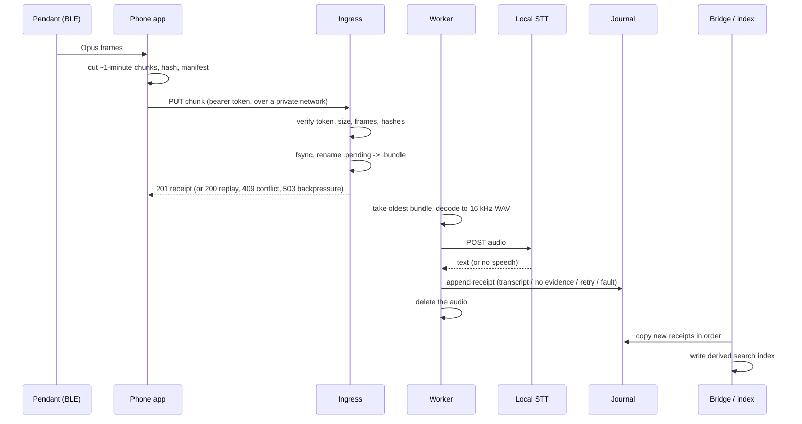

# Ambient capture: from a pendant to a transcript journal

*How a day of audio gets to the home server, becomes text, and stops existing as audio.*

## The path

Three small Node services on the home server, each a user-level systemd unit with tight resource limits, private
temp, no new privileges and a restrictive umask. No dependencies beyond Node and ffmpeg. Only the ingress listens on
the network, and only on localhost; a private-network proxy in front of it is the only way in.

## Ingress: custody first

- **Authenticate before reading the body.** The bearer token is compared (constant-time) against stored hashes of
  the app's tokens; the server never keeps the tokens themselves.
- **Validate everything.** Body at most 8 MiB, at most 100,000 packets, each 1 to 4,096 bytes, in index and time
  order; SHA-256 of the body must equal both the header and the manifest; the manifest has exactly the expected keys,
  and the chunk id must equal a hash of the session id and sequence number.
- **Durable before acknowledged.** A chunk is written to `<id>.pending/` with fsync and renamed to `<id>.bundle`
  before the 201. A replay of the same bytes gets the original receipt; same id with different bytes gets 409.
  More than 256 waiting bundles gets 503, so the phone keeps the audio and retries later.
- **Crash recovery.** Half-written `.pending` folders found at start-up are either completed or moved to quarantine.

## Worker: one writer, receipts for everything

- A single-writer lease (a lock plus a generation number) so two workers can never both append.
- Every 100 ms it takes the oldest bundle, decodes it with ffmpeg to canonical 16 kHz mono WAV, and calls the local
  speech-to-text service.
- **Every outcome becomes a receipt** in the journal: captured; transcript (plus an "episode"); "no speech in this
  chunk"; retry scheduled; and, after three attempts, a terminal fault with the bundle moved aside. Erasure requests
  have their own receipt type.
- **Audio is deleted as soon as its chunk is settled.** Only text is kept. (Voice-note audio, a separate path, follows
  a 24 to 48 hour retention rule.)
- Accounting is checkable: receipt counts by type sum to the last sequence number, and transcripts plus "no speech"
  equal captures, so every capture has exactly one outcome.

## Bridge: a derived index

The bridge copies new receipts in sequence order into a derived index for Navi's daytime recall tools, applies
erasures, and skips work entirely when the journal hasn't changed. That last part was a fix: the first version
rewrote ~200 MB every few seconds while idle (bad for an SSD); it now writes nothing when nothing is new.

## The night reads the journal, not the index

The nightly engine reads the journal read-only, once per run, under a scoped grant, turns transcripts into one
evidence unit per chunk plus gap markers for "no speech", retries and faults, and buckets them by local day. See
[the nightly engine](nightly-memory-engine.md).

## Speech-to-text

- **Pendant chunks:** a Whisper-family turbo model on the integrated GPU (CTranslate2, ROCm) as one shared service.
  It is the GPU's long-running client; everything else in the voice stack stays on the CPU unless planned otherwise.
- **Foreign-language speech is never filtered or dropped.** It is transcribed and kept like anything else.
- **Speaker labels** (owner, other, TV, unknown) come from an enrolled voice profile, scored on speech segments. They
  are logs that improve the night's judgement. They never grant anyone the owner's abilities.

## Open mic: talking to Navi hands-free

A separate, live path. The choice was a **cascade** (speech-to-text, then Navi's real brain, then text-to-speech)
rather than a speech-to-speech model, because the brain has to be *her*, with her memory and tools.

- **Stack:** Pipecat (chosen in a bake-off: faster, tighter latency tail, and an official Android WebRTC client),
  Parakeet TDT 0.6B on the CPU for speech-to-text (63 to 184 ms per clip in our tests), Smart Turn for end of turn,
  Kokoro for speech out, spoken clause by clause (first sound in about 0.5 s).
- **Measured:** warm median 1.7 s, p95 2.7 s from end of speech to Navi's reply starting, over 96 test turns.
- **Guarded barge-in:** the reply ducks within ~50 ms when you start talking, and only stops on confirmed speech,
  a command, or three or more words, so "mm-hm" doesn't cut her off.
- **A term fixer** (Metaphone matching), because Parakeet takes no hotwords: on a synthetic name set it lifted
  correct names from 131 to 150 of 152.
- **Only committed turns** go to the agent; there is no speculative brain.

Things that were wrong first are in [lessons learned](lessons-learned.md) (echo that wasn't echo, a threshold that
accepted 19% of the owner, the car).

## Open problems

- The journal is rewritten whole on every append and is never pruned. At the current rate it reaches the engine's
  256 MiB read limit in about five months. It needs segmenting and a retention rule.
- A replayed chunk id can be accepted again once the worker has moved the original out of intake; only the worker's
  per-capture state prevents a duplicate entry. It holds, but the guarantee lives in the wrong place.
